# Lab4Web — Laporan Praktikum 4: CSS Layout

README ini mengikuti urutan materi pada **Modul Praktikum Pemrograman Web, Praktikum 4: CSS Layout**. Setiap bagian dilengkapi gambar **hasil tampilan** tahap tersebut. Tidak ada screenshot kode pada dokumentasi ini.

> **Catatan:** gambar pada `screenshots/hasil-praktikum/` adalah ilustrasi visual hasil tiap tahap berdasarkan project. Untuk laporan yang mensyaratkan bukti eksekusi langsung, tambahkan screenshot browser dari laptop sendiri.

## Persiapan Praktikum

1. Siapkan Visual Studio Code atau editor teks lain.
2. Buka folder `Lab4Web`.
3. Jalankan file HTML dengan browser atau ekstensi Live Server.

## Langkah 1 — Membuat Box Element

File: `lab4_box.html`. Tiga kotak `div` dibuat dengan padding dan warna latar berbeda.

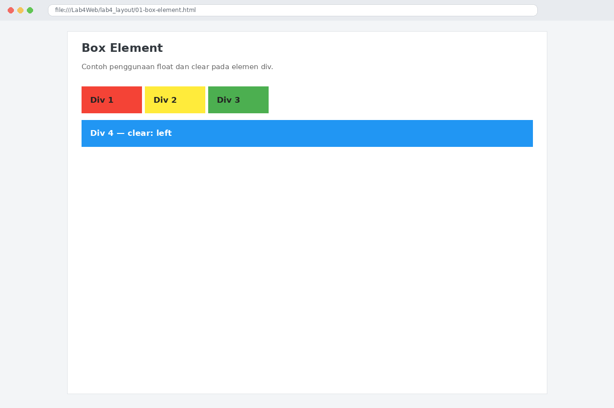

## Langkah 2 — CSS Float dan Clear

`float: left` menempatkan tiga div pertama berdampingan. Div 4 menggunakan `clear: left` agar turun ke baris berikutnya.


## Langkah 3 — Membuat Kerangka Layout Semantik

Layout terdiri dari `header`, `nav`, hero section, area `main`, `aside` untuk sidebar, dan `footer`.

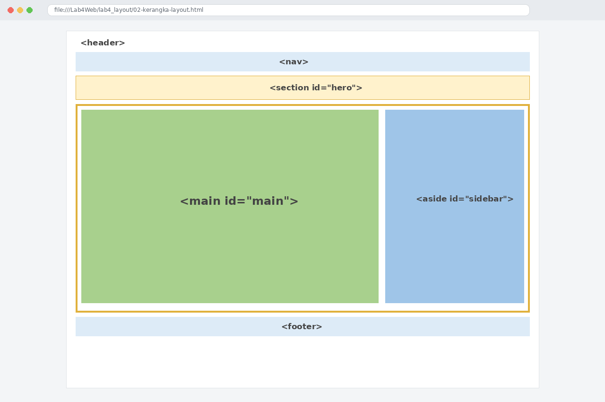

## Langkah 4 — Membuat Header

Header berisi judul Layout Sederhana dan diatur dengan padding serta warna teks.


## Langkah 5 — Membuat Navigasi

Navigasi berisi Home, Artikel, About, dan Kontak. Link aktif diberi warna biru yang lebih terang.

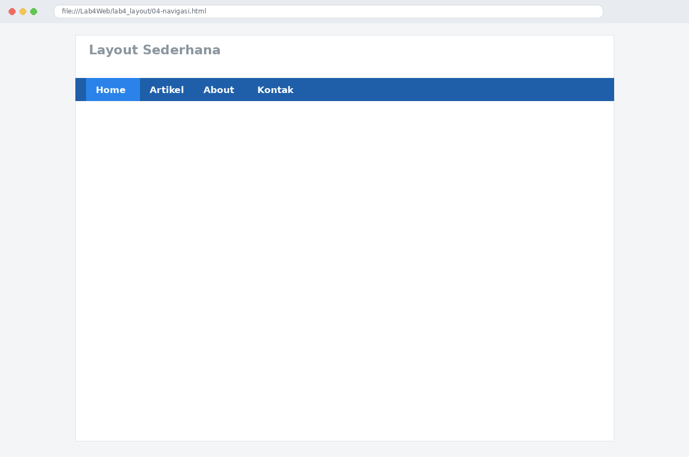

## Langkah 6 — Membuat Hero Panel

Hero panel berisi judul, deskripsi, dan tombol Learn more.

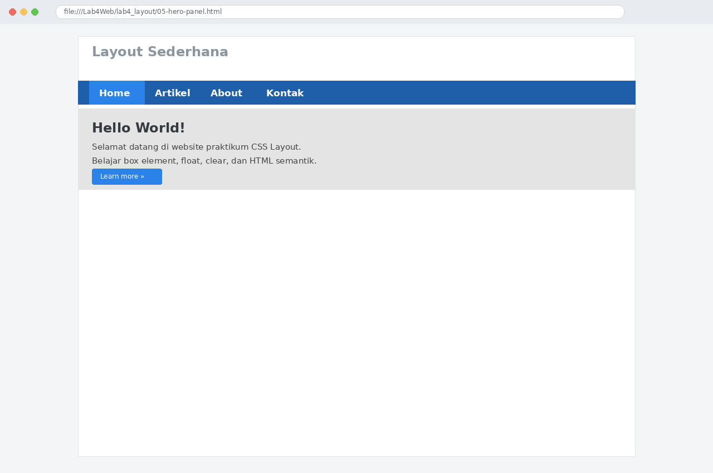

## Langkah 7 — Mengatur Main Content dan Sidebar

Area wrapper membagi halaman menjadi konten utama di kiri dan sidebar di kanan.


## Langkah 8 — Membuat Sidebar Widget

Sidebar berisi Widget Header berupa daftar tautan dan Widget Text untuk informasi tambahan.

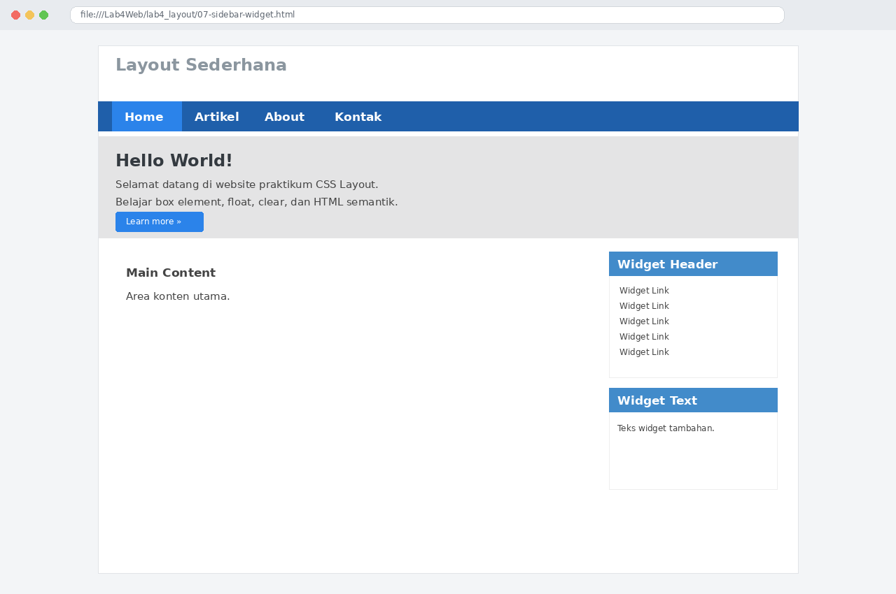

## Langkah 9 — Mengatur Footer

Footer ditempatkan di bagian bawah halaman dengan latar gelap dan teks terang.

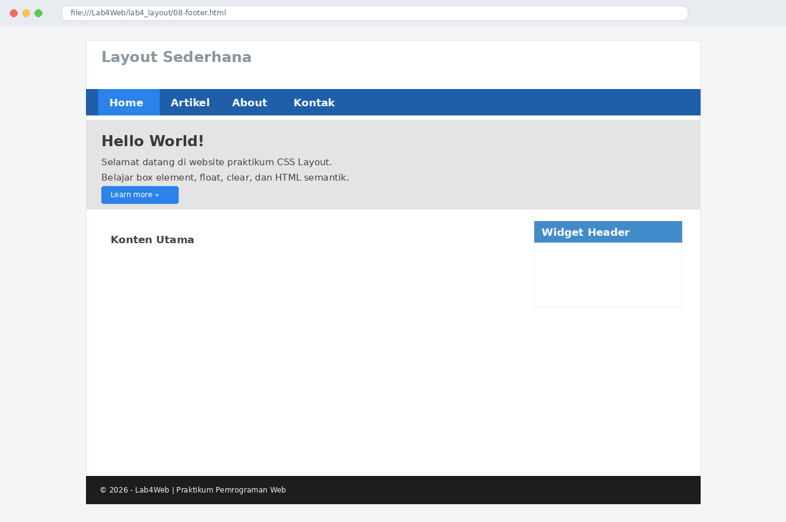

## Langkah 10 — Menambahkan Kartu Konten

Tiga kartu berisi ilustrasi, judul, deskripsi, dan tombol detail.

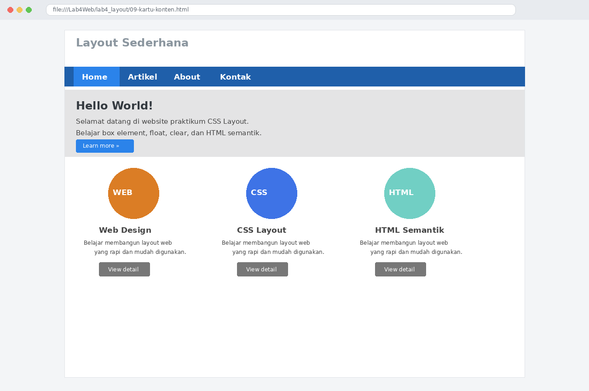

## Langkah 11 — Menambahkan Content Artikel

Dua artikel menggunakan elemen `article`. Gambar artikel pertama berada di kiri dan gambar artikel kedua berada di kanan.

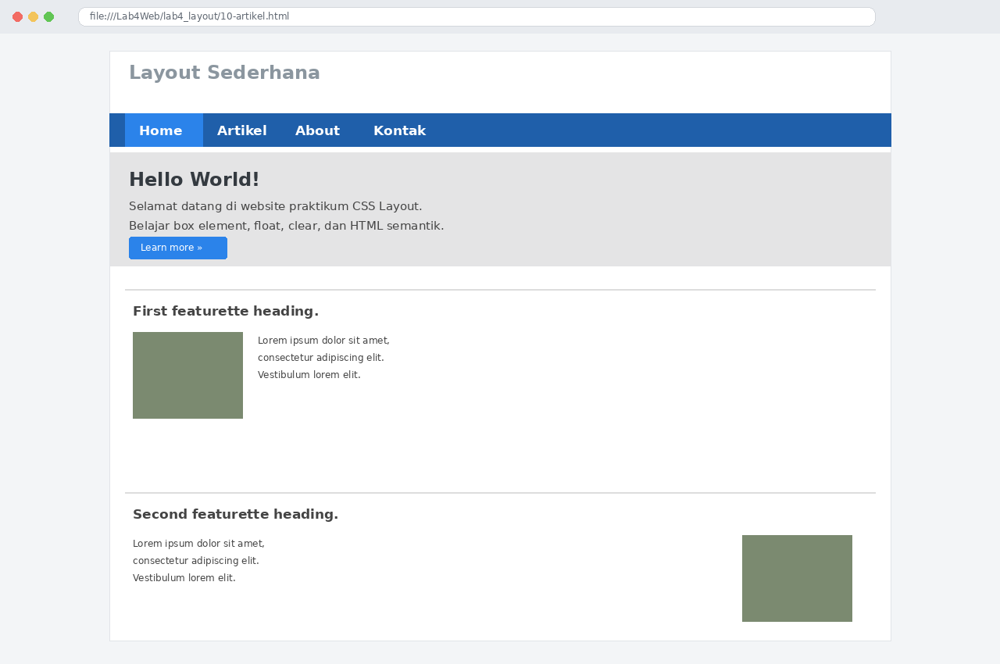

## Langkah 12 — Tampilan Home Lengkap

Halaman utama menggabungkan header, navigasi, hero, kartu konten, artikel, sidebar, dan footer.

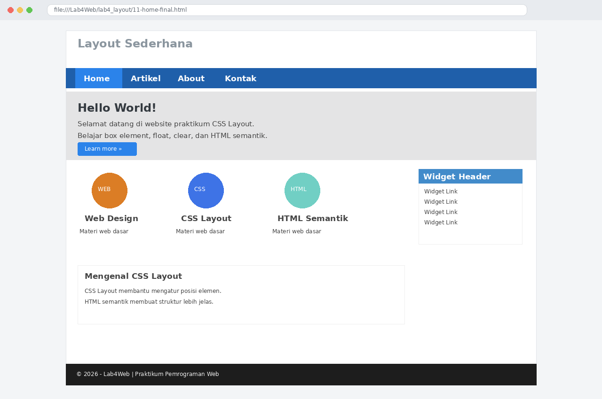

## Langkah 13 — Halaman Artikel

Halaman Artikel memuat ringkasan materi CSS Layout dan HTML semantik.

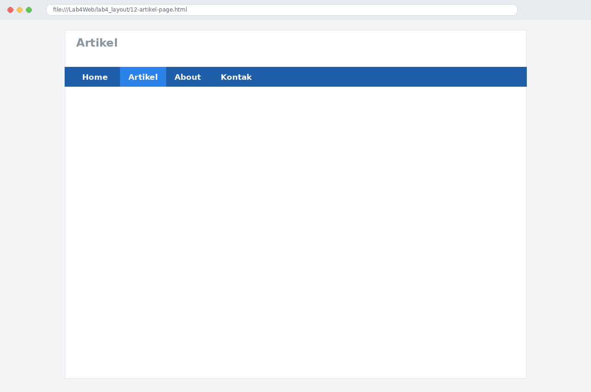

## Langkah 14 — Halaman About

Halaman About berisi deskripsi, keahlian yang dipelajari, dan portfolio sederhana.

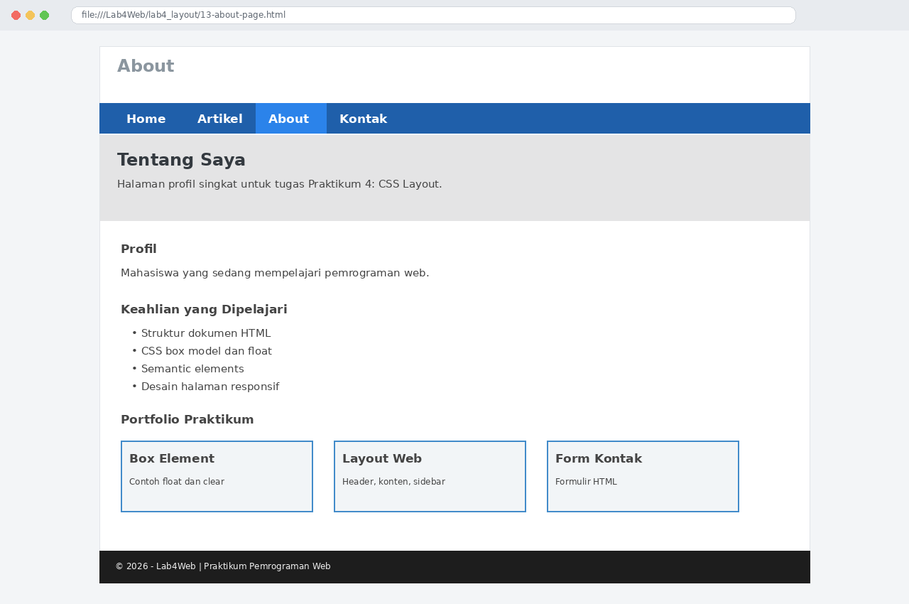

## Langkah 15 — Halaman Contact

Form Contact berisi Nama, Email, Subjek, dan Pesan. Form ini berupa tampilan HTML dan belum terhubung ke backend.

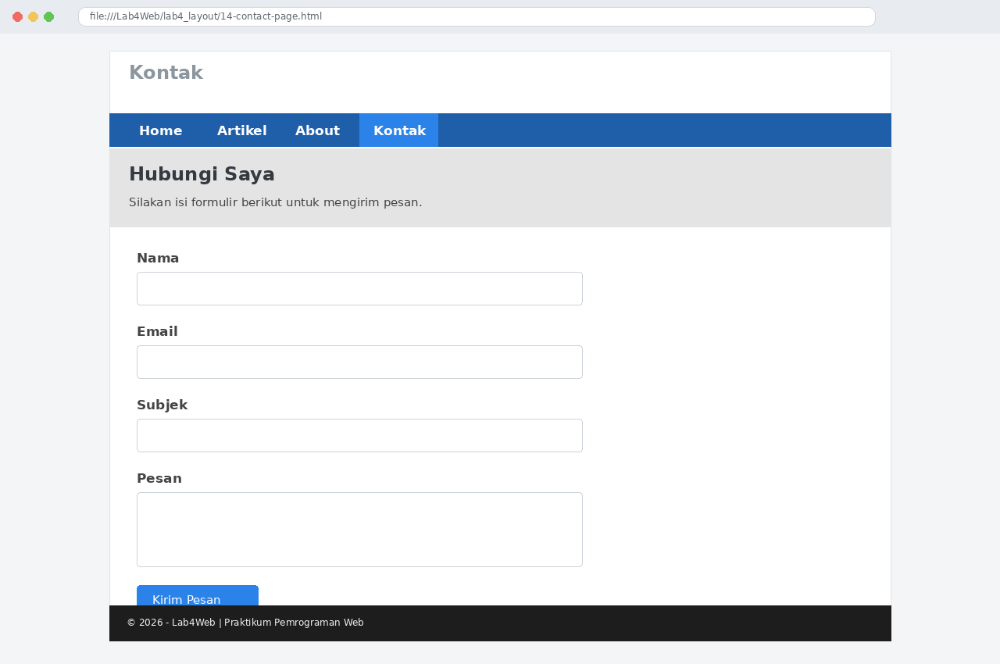

## Langkah 16 — Pengujian dan Validasi

1. Buka `lab4_box.html` dan amati posisi Div 1–4.
2. Buka `lab4_layout/home.html`.
3. Coba semua menu navigasi.
4. Uji validasi dasar form Contact.
5. Periksa tampilan pada ukuran layar berbeda.
6. Validasi HTML melalui https://validator.w3.org/nu/.

## Langkah 17 — Repository GitHub

Buat repository `Lab4Web`, lalu jalankan perintah berikut dari terminal di folder project:

```bash
git init
git add .
git commit -m "Praktikum 4 CSS Layout"
```

Hubungkan ke repository GitHub yang dibuat dan lakukan `git push`. Pastikan file HTML/CSS, README, dan folder screenshot ikut terunggah.

## Kesimpulan

Praktikum melatih penggunaan box element, `float`, `clear`, HTML semantik, layout website, sidebar widget, footer, konten artikel, serta halaman About dan Contact.
