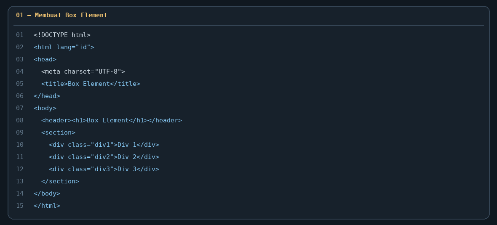
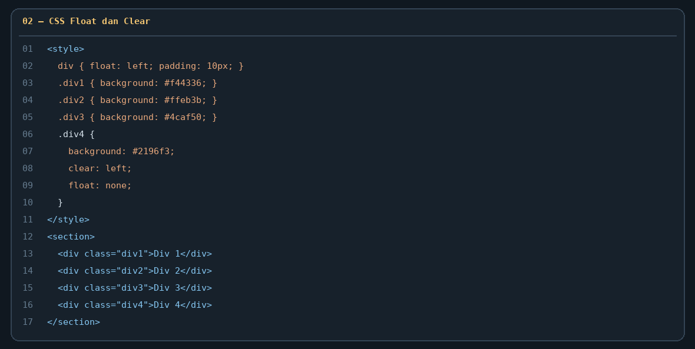
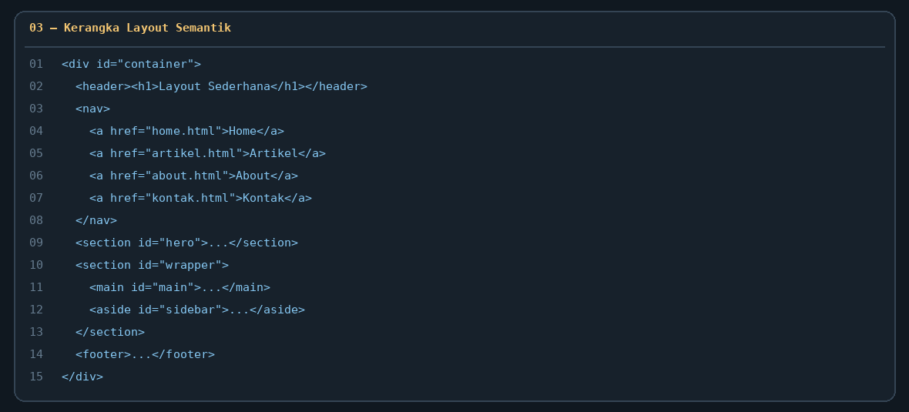
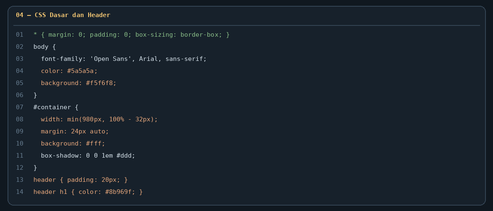
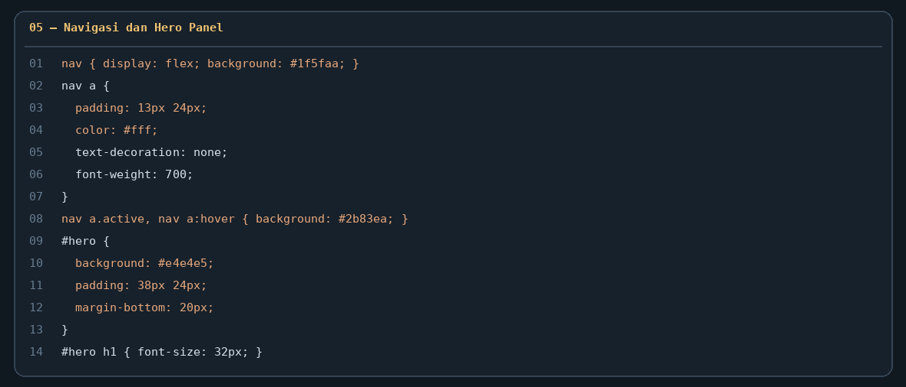
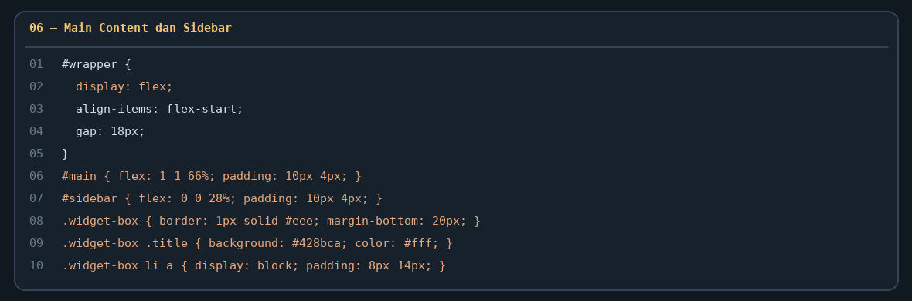
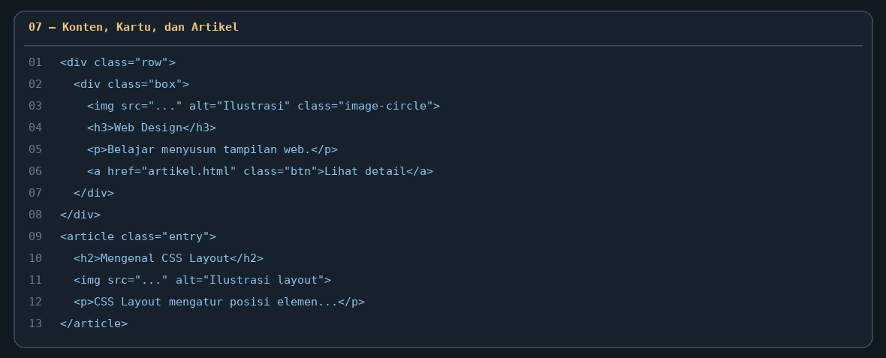
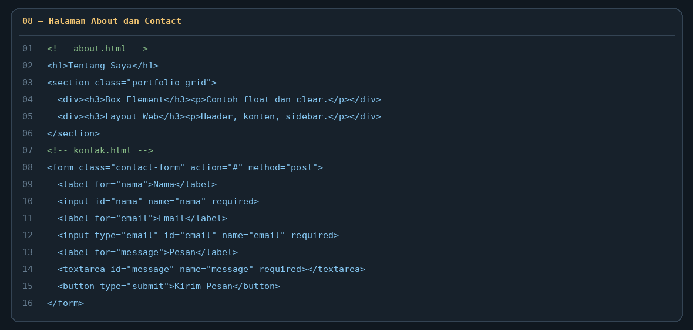

# Lab4Web — Laporan Praktikum 4: CSS Layout

README ini disusun mengikuti urutan materi pada **Modul Praktikum Pemrograman Web — Praktikum 4: CSS Layout**. Gambar yang disertakan merupakan ilustrasi potongan kode dari file project, bukan screenshot yang diambil langsung dari VS Code atau browser. Untuk laporan final, tambahkan screenshot hasil tampilan browser dari komputer sendiri jika dosen meminta bukti eksekusi.

## Persiapan Praktikum

1. Siapkan editor kode, misalnya Visual Studio Code.
2. Buka folder `Lab4Web` di VS Code.
3. File latihan box ada di `lab4_box.html`; file layout ada di folder `lab4_layout`.
4. Buka file HTML di browser atau gunakan ekstensi Live Server.

## Langkah 1 — Membuat Dokumen HTML dan Box Element

**Tujuan:** Membuat halaman dasar dengan judul dan tiga elemen `div`.

File: `lab4_box.html`

Elemen yang digunakan:
- `header` untuk judul halaman.
- `section` untuk mengelompokkan kotak.
- `div` dengan class `div1`, `div2`, dan `div3` sebagai box.



**Hasil yang diharapkan:** Tiga kotak berwarna merah, kuning, dan hijau muncul sejajar karena masing-masing elemen diberi CSS float.

## Langkah 2 — Menerapkan CSS Float Property

**Tujuan:** Membuat elemen mengambang ke sisi kiri menggunakan `float: left`.

Pada file `lab4_box.html`, deklarasi CSS memberi `padding: 10px` dan warna latar yang berbeda pada masing-masing kotak.



**Hasil yang diharapkan:** Div 1, Div 2, dan Div 3 berada pada satu baris selama ruang mencukupi.

## Langkah 3 — Mengatur Clear pada Elemen Berikutnya

**Tujuan:** Mempraktikkan properti `clear` agar elemen berikutnya turun ke baris baru.

Class `.div4` menggunakan `clear: left` dan `float: none`. Coba ganti nilai `clear` menjadi `both` atau `right`, lalu amati perbedaannya.

**Hasil yang diharapkan:** Div 4 tampil di bawah kotak-kotak yang menggunakan float.

## Langkah 4 — Membuat Kerangka Layout Sederhana

**Tujuan:** Menyusun bagian utama website dengan elemen HTML semantik sesuai materi.

File: `lab4_layout/home.html`

Struktur layout terdiri dari:
- `header` — judul website.
- `nav` — menu navigasi Home, Artikel, About, dan Kontak.
- `section#hero` — panel pengantar.
- `main#main` — konten utama.
- `aside#sidebar` — widget samping.
- `footer` — bagian bawah halaman.



## Langkah 5 — Mengatur CSS Dasar dan Header

File: `lab4_layout/style.css`

CSS reset menyamakan margin dan padding awal. Bagian `body` mengatur font dan warna teks, sedangkan `#container` mengatur lebar konten, posisi tengah, latar, dan bayangan. Header diberi padding dan warna teks judul.



## Langkah 6 — Membuat Navigasi dan Hero Panel

Navigasi menggunakan latar biru. Link menu diberi padding, warna teks putih, dan efek hover. Hero panel menggunakan latar abu-abu, jarak dalam, judul, deskripsi, dan tombol menuju halaman About.



**Hasil yang diharapkan:** Menu tampil sebagai baris navigasi biru dan hero tampil sebagai panel pengantar di bawahnya.

## Langkah 7 — Mengatur Main Content, Sidebar, dan Widget

Bagian `#wrapper` menempatkan konten utama dan sidebar berdampingan. Sidebar berisi widget daftar tautan dan widget teks. CSS juga mengatur jarak, border, warna judul widget, dan efek hover pada tautan.



## Langkah 8 — Menambahkan Kartu Konten dan Artikel

Halaman Home memiliki tiga kartu materi, kemudian artikel yang menjelaskan CSS Layout dan HTML semantik. Gambar pada artikel diatur menggunakan float agar teks dapat mengalir di samping gambar.



## Langkah 9 — Membuat Halaman About

File: `lab4_layout/about.html`

Halaman About berisi deskripsi singkat, daftar materi/keahlian yang dipelajari, dan portfolio sederhana. Halaman ini menggunakan stylesheet yang sama agar tampilannya konsisten dengan halaman Home.

## Langkah 10 — Membuat Halaman Contact

File: `lab4_layout/kontak.html`

Form Contact berisi input Nama, Email, Subjek, dan Pesan. Atribut `required` dan `type="email"` membantu validasi dasar dari browser. Form ini belum terhubung ke backend, jadi belum benar-benar mengirim data.



## Langkah 11 — Pengujian Halaman

1. Buka `lab4_box.html` di browser dan amati posisi Div 1 sampai Div 4.
2. Buka `lab4_layout/home.html`.
3. Klik menu Artikel, About, dan Kontak untuk memastikan semua halaman dapat dibuka.
4. Uji form Contact dengan mengosongkan kolom wajib dan perhatikan validasi browser.
5. Ubah ukuran jendela browser untuk memeriksa tampilan responsif.
6. Ambil screenshot **langsung dari browser dan VS Code** untuk melengkapi laporan praktikum.

## Langkah 12 — Validasi HTML

Validasi setiap dokumen HTML menggunakan W3C Nu HTML Checker: https://validator.w3.org/nu/

Periksa file `lab4_box.html`, `lab4_layout/home.html`, `artikel.html`, `about.html`, dan `kontak.html`. Jika validator menampilkan error, perbaiki lalu periksa kembali.

## Langkah 13 — Repository GitHub dan Commit

1. Buat repository baru bernama `Lab4Web` di GitHub.
2. Buka terminal VS Code di dalam folder project.
3. Jalankan perintah berikut:

```bash
git init
git add .
git commit -m "Praktikum 4 CSS Layout"
```

4. Hubungkan folder lokal ke repository GitHub sesuai URL repository yang dibuat, kemudian lakukan `git push`.
5. Pastikan `README.md`, file HTML, CSS, dan folder `screenshots` ikut terunggah.
6. Kirim URL repository ke e-learning sesuai instruksi dosen.

## Kesimpulan

Praktikum ini melatih penggunaan box element, `float`, `clear`, elemen semantik HTML5, dan penyusunan layout website yang terdiri dari header, navigasi, hero, konten, sidebar, dan footer. Tugas pengembangan juga mencakup halaman About dan Contact.

## Catatan Screenshot

Gambar pada README ini adalah **ilustrasi potongan kode yang dirapikan dari project**, bukan screenshot asli layar editor. Tambahkan screenshot browser/VS Code hasil eksekusi sendiri sebelum mengumpulkan laporan jika diwajibkan dosen.
